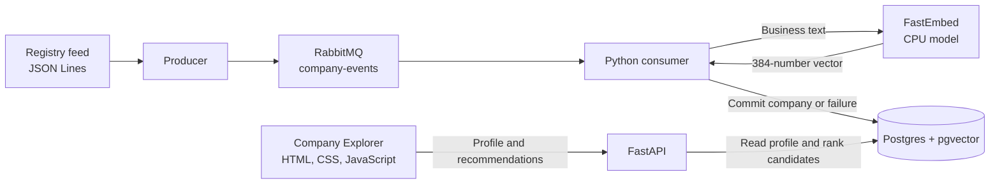
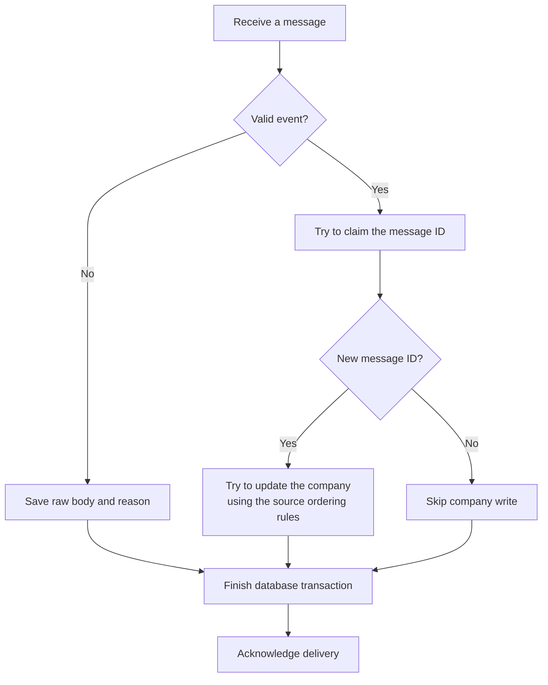

# Company recommendation system design

The portal looks up a Malaysian company by registration number and recommends active companies with similar business activities. RabbitMQ delivers registry events, a Python consumer maintains the latest company state, and Postgres ranks candidates with pgvector. The browser reads the company profile and recommendations from FastAPI.

## Run the project from start to finish

Start Docker and make sure `uv` and `just` are installed. Run the commands below from the repository root. `uv` manages Python 3.14 and the project dependencies. Internet access is needed the first time the consumer downloads the embedding model. [Prerequisites](README.md#getting-started)

### 1. Set up the services and start the consumer

In **terminal 1**, run these in order.

```bash
just setup
just up
just schema
just consume
```

`just setup` installs the dependencies. `just up` starts Postgres and RabbitMQ. `just schema` enables pgvector and creates the tables. Leave `just consume` running and wait for `Consuming from company-events`. If your database still has vectors from the earlier hashed baseline, run `just reembed` after `just schema` and before starting the consumer.

### 2. Publish the feed and start the portal

In **terminal 2**, run:

```bash
just publish
just api
```

`just publish` sends the 2,518 feed lines to RabbitMQ. Terminal 1 shows an outcome as the consumer handles each delivery. Leave `just api` running, then open [Company Explorer](http://127.0.0.1:8000/) once ingestion is ready. Look up `SYN-001550`, check the similarity bars, then click a result to open that company's profile.

### 3. Check the API and run the tests

In **terminal 3**, run:

```bash
curl --fail --silent --show-error 'http://127.0.0.1:8000/companies/SYN-001550/similar?limit=5'
just test
```

The sample request returns five ranked cards in a `recommendations` list. `just test` runs the ingestion and API checks. To stop the project and keep the data for later, press **Ctrl+C** in terminals 1 and 2, then run `docker compose stop`.

## Architecture



| Table | Key | Purpose |
| --- | --- | --- |
| `companies` | Registration number | Holds the current profile, source timestamp, active status, and vector with its model label. |
| `processed_messages` | AMQP message ID | Records valid events already handled, including stale events. |
| `failed_messages` | AMQP message ID and body hash | Keeps the original bytes, validation reason, and failure time for review. The message ID can be null when it is missing or unusable. |

## Ingestion and acknowledgement

The producer sends one line per message and hashes that line to create its AMQP message ID. The consumer uses the registry team's durable `company-events` queue with no extra queue arguments. Each consumer handles one unacknowledged delivery at a time.



| Outcome | What happens in Postgres |
| --- | --- |
| Applied | The message ID and the company change commit in the same transaction. |
| Duplicate | The ID is already recorded, so the consumer skips embedding and the company write. |
| Stale | The database records the message ID and keeps the newer or higher-priority company version. |
| Rejected | The consumer records the validation failure before acknowledging. Replaying the same invalid ID and body keeps one failure record. |

Validation checks the JSON object, supported event type, message ID, registration number, timezone-aware `updatedAt`, and the presence of an upsert data object. If the transaction fails, its message claim rolls back so RabbitMQ can redeliver it. If the transaction commits and the acknowledgement is lost, the saved message ID lets the consumer acknowledge the replay without rewriting the company.

On a transient database or connection error, the consumer closes its connections and leaves any unfinished delivery unacknowledged. It tries to reconnect after 1 second, then doubles the delay up to 30 seconds. A completed delivery resets the delay. A live check terminated the consumer's Postgres session and verified that the delivery was applied after reconnecting. [Consumer](consumer/__main__.py) · [Schema](db/schema.sql)

## Choosing the current company record

| Priority | Rule |
| --- | --- |
| 1. Source time | The later `updatedAt` wins, regardless of arrival order. |
| 2. Event status | At equal timestamps, a strike-off wins over an upsert. |
| 3. Message ID | If timestamp and status match, the lexicographically greater ID wins using Postgres's `C` collation. |

A strike-off stores a company as inactive even when there is no existing row. Keeping the strike-off timestamp prevents older or same-time upserts from restoring the record. A strictly newer upsert can reactivate the company. The API hides inactive companies from both profile lookups and recommendations.

Missing card fields stay null. Usable partial records remain in the database, and the embedder falls back from business description to industry. If neither contains usable text, the embedding stays null. Every registration identifiable in the supplied feed had at least one usable event.

## Embeddings and ranking

I chose `BAAI/bge-small-en-v1.5` from the brief after verifying that FastEmbed runs it on Python 3.14. It produces 384-dimensional vectors on CPU and loads once per consumer process. The first model load downloads the weights into a local cache. Its English focus is a limitation for this mixed-language feed. [Embedder](embeddings.py) · [Setup and model download](README.md#getting-started)

The initial development vectors used a hashed bag of words. `just reembed` uses the current text in Postgres to migrate old rows in one transaction. It preserves source events and processed message IDs. Each row carries the name of its embedding model, allowing the API to compare vectors only within the same model. [Rebuild script](scripts/reembed.py)

Postgres uses exact cosine distance (`<=>`) to rank active candidates. It excludes the source company and candidates with missing, zero, or different-model embeddings. Equal distances use registration number as a stable tie-breaker. The portal shows `100 × clamp(1 − distance, 0, 1)` as a similarity percentage and bar. The original distance controls the ranking even when displayed percentages look equal. The score describes similarity between business-text vectors.

| Request or condition | Response |
| --- | --- |
| `GET /companies/{registration_number}` | Active profile with registration number, name, industry, state, and description. |
| `GET /companies/{registration_number}/similar?limit=5` | Ranked cards with registration number, name, industry, state, and similarity percentage. Default 5, allowed range 1–100. |
| Unknown or inactive source | HTTP 404. |
| Active source with no usable vector or no eligible matches | HTTP 200 with an empty recommendations list. |
| Invalid limit | HTTP 422. |

[API implementation](api/main.py)

## Verification

From the repository root, run `just verify` to repeat the automated tests, fresh setup, feed and replay checks, live API checks, ranking examples, SQL benchmark, and database reconnect test. Run `just verify-browser` to include the Chromium checks at desktop and phone widths. The browser command installs Chromium if needed. Both commands use a temporary Compose project with its own ports and remove it afterward.

A fresh Compose project validated the README setup against an empty database and queue. Each publish sent 2,518 deliveries.

| Run | Applied | Duplicate | Stale | Rejected |
| --- | ---: | ---: | ---: | ---: |
| First full feed | 2,308 | 63 | 66 | 81 |
| Full replay | 0 | 2,437 | 0 | 81 |

Postgres ended with **2,049 companies** and **76 unique failure records**. The replay preserved every company row version and left RabbitMQ with zero ready or unacknowledged deliveries.

| Check | Observed result |
| --- | --- |
| Automated tests | All seven passed. They cover writes, duplicate delivery, rollback, ordering, strike-offs, bad input, incomplete fields, retries, and API ranking and limits. |
| Live API | Returned 5 and 100 results for `SYN-001550`, an empty list for an unscored company, HTTP 404 for an unknown registration, and HTTP 422 for a limit of 101. |
| Exact SQL ranking | Median **1.13 ms** (0.97–1.48 ms) across 30 warm runs for `SYN-001550` at limit 5. This is local database execution time. |
| Malay-language spot check | The rubberwood furniture company returned five companies with the same Malay business description. |
| Recommendation miss | The café returned three café or coffee shop matches and two parcel-delivery companies that shared the Klang Valley phrase. |

[Automated tests](tests/test_ingestion.py)

## What I would change at 10× volume

I would test with about 20,000 companies and a larger batch of registry updates. I would make changes only where the test shows a slowdown.

| Area | What I would check | What I would try first |
| --- | --- | --- |
| **Recommendation latency** | Postgres compares the selected company with every eligible company. I would measure how long users wait for 5 or 100 results when several people search at once. | If searches become too slow, I would try a vector index. It helps Postgres find likely matches faster. I would compare its top results with the current search to see whether it misses good matches. |
| **Ingestion throughput** | Each consumer handles one message at a time. I would publish a larger batch and check how long the oldest message waits and how long the queue takes to empty. | If updates pile up and the machine has spare CPU capacity, I would run a second consumer and measure again. Postgres already checks message IDs and source timestamps, so both consumers can work from the same queue while keeping company records consistent. |

## AI assistance

I used **OpenAI Codex** as a development assistant throughout the project.

| Use | What Codex helped with |
| --- | --- |
| Implementation | Drafted the consumer's transaction, acknowledgement, and retry logic, the pgvector query and FastAPI endpoints, the model rebuild script, and the HTML, CSS, and JavaScript portal. |
| Verification | Added automated cases for replay, rollback, ordering, malformed input, and API bounds. Ran the fresh Compose smoke test, compared Postgres row versions across a full replay, benchmarked the SQL query, and checked the portal in a browser. |
| Documentation and design | Helped turn observed results into the handoff notes and diagrams, and document ranking misses. |

The running application uses the local BGE embedding model to turn business text into vectors. Codex was used during development.
